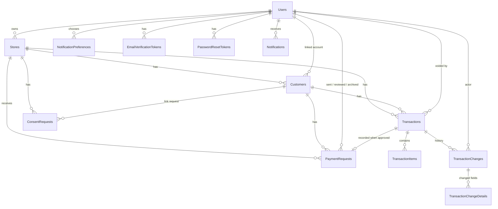

# CrediTrack database: Third Normal Form (3NF)

The database is PostgreSQL, created and changed only by EF Core migrations. The 3NF work is migration
`20261114180000_NormalizeTo3NF`. This note explains what was wrong, what changed, and what was kept on purpose.

## The three rules, in short
| Form | Rule | In CrediTrack |
|---|---|---|
| 1NF | One value per cell, no repeating groups, no lists or JSON in a column | JSON columns and a comma-joined list were broken out |
| 2NF | 1NF + every non-key column depends on the WHOLE key | Every table has a single-column key (`Id`), except `NotificationPreferences` whose two columns are both in the key, so no partial dependency is possible |
| 3NF | 2NF + no non-key column depends on another non-key column (no transitive dependency) | Copied names (`VoidedByName`, `ActorName`) were removed |

## What was wrong (before) and the fix (after)

| # | Before | Problem | After |
|---|---|---|---|
| 1 | `Users.NotificationPrefsJson` = `{"payments":true,"overdue":false}` | 1NF: many values in one cell | Table `NotificationPreferences(UserId, PrefKey, IsEnabled)`, key `(UserId, PrefKey)` |
| 2 | `TransactionChanges.ChangesJson` = `[{field, from, to}, ...]` | 1NF: repeating group in one cell | Table `TransactionChangeDetails(Id, TransactionChangeId, Field, OldValue, NewValue)` |
| 3 | `Transactions.Note` on a credit = `"Rice, Sugar, Oil"` | 1NF + redundancy: a comma list that is a copy of `TransactionItems.Name` | Not stored for credits. The pages get the same text by joining the item names. Payments keep `Note` (the owner's notes) |
| 4 | `Transactions.VoidedByName` next to `VoidedByUserId` | 3NF: `VoidedByUserId` -> name (name depends on a non-key column) | Column removed. The name is read from `Users.FullName` by `VoidedByUserId` |
| 5 | `TransactionChanges.ActorName` next to `ActorUserId` | 3NF: same transitive dependency | Column removed. The name is read from `Users.FullName` by `ActorUserId` |
| 6 | Many `...UserId` / `TransactionId` columns were plain integers | Not a normal form, but nothing stopped a row pointing at nothing | Real foreign keys (list below) |

### Foreign keys added
`Transactions.StoreId -> Stores`, `Transactions.VoidedByUserId -> Users`, `TransactionChanges.ActorUserId -> Users`,
`Customers.LinkedUserId -> Users`, `Customers.ArchivedByUserId -> Users`, `PaymentRequests.UserId -> Users`,
`PaymentRequests.ReviewedByUserId -> Users`, `PaymentRequests.ArchivedByUserId -> Users`,
`PaymentRequests.TransactionId -> Transactions`.
Optional ones use `ON DELETE SET NULL`; required ones use `RESTRICT`.

### Existing data
The migration copies the data first (JSON -> rows with `jsonb_each_text` / `jsonb_array_elements`, unreadable JSON is skipped),
clears credit notes, clears ids that point at nothing, and only then drops the old columns and adds the foreign keys.
`Down()` rebuilds the old columns from the new tables.

One visible difference: "voided by" and the Change History actor now show the account's **current** name
(before: the name at that moment). A void or change made by an account with no stored user id shows "Store Owner".

## Final tables (all in 3NF)


## Kept on purpose (be ready to explain)
- **`IsVoided`, `IsArchived`, `EmailVerified`** next to `VoidedAt`, `ArchivedAt`, `EmailVerifiedAt`: the flag can be worked out from the date
  (not null). They are kept as simple filter flags used by many queries. They can be dropped later without losing information.
- **`Transactions.Amount` for a credit** equals the sum of its items and **`BalanceBefore`** is the balance at the time of a payment:
  stored ledger values (the amount that was agreed / the balance that was shown), written once.
- **`Transactions.StoreId`** can also be reached through `Customers.StoreId`. It is kept because the receipt number is unique per store
  (`StoreId, Number`) and every ledger query is by store. It is now a real foreign key, so it cannot disagree with a missing store.
- **Text values** (`Type`, `Status`, `Method`, `Unit`) are not in lookup tables. They are small fixed sets checked by the API.
- **`PhotoPath` / `ProofPath`** point at `StoredFiles.Path` by text and have no foreign key (the file is written separately).

## Check it yourself
```
cd CrediTrack.Api
dotnet build
dotnet ef migrations has-pending-model-changes     # must say there are no pending changes
dotnet run                                          # the migration runs on start
```
In `psql`: `\d "TransactionChanges"` (no ChangesJson / ActorName), `\d "NotificationPreferences"`, `\d "TransactionChangeDetails"`.
